# AI-агент для первичной обработки заявок на закупку

**Организация**: ООО «Северная Логистика» (вымышленная компания)
**Тип работы**: учебный проект, концепция AI-решения
**Период данных**: 2025 год, синтетический набор
**Дата отчёта**: ноябрь 2026
**Материалы проекта**: каталог `AI-Procurement-Agent` (данные, код, расчёты, демо)

## 1. Резюме проекта

ООО «Северная Логистика» — вымышленная логистическая компания со штатом 780 человек и 14 подразделениями. В 2025 году сотрудники подали 2 400 заявок на закупку общим объёмом около 734 млн ₽. Заявки приходят по трём каналам (1С:Заявки, электронная почта, Excel), а первичную обработку выполняют четыре категорийных закупщика вручную: переносят данные в карточку, проверяют бюджет, ищут дубликаты, запрашивают недостающее и только потом запускают процедуру.

Проект предлагает AI-агента «ЗакупКИ», который берёт на себя первичную обработку: извлекает поля из свободного текста, определяет категорию, проверяет полноту и формальные правила, ищет похожие заявки, оценивает риск и готовит черновик сообщения и карточки. Все внешние действия (отправка письма, создание заказа) остаются за человеком.

Ключевые результаты проекта:

**Таблица 1.** Сводные показатели проекта

| Показатель | Значение |
|---|---|
| Исходный и подготовленный наборы | 2 400 → 2 236 заявок, 20 признаков |
| Удалено дубликатов | 164 (6,8%), ещё 68 помечены для человека |
| Точность классификатора категорий | 0,946 accuracy, 0,941 macro-F1 |
| Экономия времени на заявку (допущение) | 23 минуты (35 → 12) |
| Годовой эффект | 1 120 804 ₽ |
| Разовые затраты / постоянные в год | 1 100 000 ₽ / 240 681 ₽ |
| Чистый годовой эффект | 880 122 ₽ |
| Окупаемость | 15,0 месяца |
| Точка безубыточности | 2 688 заявок в год |
| NPV за 3 года при ставке 20% | 918 317 ₽ |

Главный вывод: решение экономически осмысленно, но его окупаемость держится на одном допущении — что агент действительно сокращает ручную работу на 23 минуты на заявку. При экономии 15 минут окупаемость растягивается до 25 месяцев, при 30 минутах сокращается до 11. Поэтому первый этап внедрения должен быть не разработкой «под ключ», а пилотом с хронометражем процесса.

## 2. Этап 1. Проблема и AI-продукт

### 2.1 Компания и контекст

«Северная Логистика» оказывает складские и транспортные услуги, содержит собственный автопарк и складской комплекс. Закупки децентрализованы на уровне заявок: любое подразделение может запросить технику, канцелярию, услуги подрядчиков, ремонт или обучение, но сама процедура централизована в отделе закупок.

Процесс в текущем виде:

1. Заявитель описывает потребность в свободной форме и отправляет её в 1С:Заявки, письмом или Excel-файлом.
2. Закупщик вручную переносит данные в карточку: предмет, количество, единицу, цену, сумму, бюджетный код, срочность, поставщика.
3. Закупщик проверяет бюджет, корректность суммы, наличие дубликата и соответствие пороговым правилам.
4. При неполной заявке он пишет заявителю и ждёт ответа; заявка возвращается на доработку.
5. При сумме выше порога запускается конкурентная процедура, при сумме выше 1 млн ₽ — согласование закупочного комитета.
6. Только после этого создаётся заказ и начинается работа с поставщиком.

**Таблица 2.** Текущий процесс: шаги, исполнители и потери

| Шаг | Кто выполняет | Оценка времени | Основная проблема |
|---|---|---|---|
| Приём и чтение заявки | Закупщик | 3–5 мин | Три канала, разный формат |
| Перенос полей в карточку | Закупщик | 10–15 мин | Ручной ввод, опечатки |
| Проверка бюджета и суммы | Закупщик, финансы | 5–8 мин | Нет автоматической сверки |
| Поиск дубликатов | Закупщик | 3–7 мин | Только по памяти и по номеру |
| Запрос уточнений | Закупщик, заявитель | 2–4 мин + ожидание | До 2–3 итераций |
| Подготовка решения | Закупщик, руководитель | 5–10 мин | Правила в разных документах |
| **Итого на заявку** | | **≈ 35 мин** | Оценка, требует хронометража |

Оценка 35 минут — допущение, а не измеренный факт: в вымышленной компании нет системы хронометража, а в открытых источниках таких данных для конкретной организации не существует. Именно поэтому экономическая модель ниже проверяет чувствительность к этому параметру, а план внедрения начинается с замера.

### 2.2 Проблема и целевой пользователь

Проблема формулируется не как «закупщики медленно работают», а как **разрыв между качеством входа и требованиями процесса**: заявки приходят в свободной форме, а для запуска закупки нужны структурированные, полные и проверенные данные. Разрыв закрывается ручным трудом закупщика, и именно он создаёт измеримые потери.

Данные 2025 года показывают четыре симптома:

- **Возвраты на доработку — 13,7% заявок.** Возвращённая заявка обрабатывается в среднем 7,17 дня против 4,58 дня у одобренной, то есть возврат почти удваивает срок.
- **Неполные заявки.** Средний индекс полноты — 0,878, у 11,5% заявок он ниже 0,7. Каждая десятая заявка требует переписки до начала работы.
- **Дубликаты — 6,8%.** 164 заявки из 2 400 повторяют уже поданные; при ручном поиске часть совпадений не находится.
- **Поставщик не указан в 57,6% заявок.** Это не ошибка данных, а особенность процесса: поставщика подбирают позже, но из-за этого невозможно быстро проверить цену.

**Целевые пользователи:**

- **Категорийный закупщик** — основной пользователь. Получает готовую карточку, список замечаний и черновик письма; тратит время на проверку, а не на ввод.
- **Заявитель** — получает понятный запрос недостающих данных вместо серии уточнений.
- **Руководитель закупочного комитета** — получает сводку риск-факторов и обоснование маршрута.
- **Служба безопасности и финансы** — получают единые правила проверки и журнал решений.

### 2.3 Предлагаемое AI-решение

«ЗакупКИ» — агент первичной обработки. Он не заменяет закупщика и не принимает финансовых решений, а доводит заявку до состояния, в котором человек может принять решение за минуту.

**Что агент получает:** текст заявки, структурные поля из формы (если есть), историю заявок, справочники категорий и подразделений, пороговые правила закупок, медианные цены по категориям.

**Что агент делает:**

1. Извлекает из текста количество, единицу, сумму, бюджетный код, срочность, поставщика, срок и обоснование.
2. Определяет категорию закупки и уверенность классификации.
3. Считает полноту и перечисляет недостающие поля.
4. Ищет точные и похожие заявки в истории.
5. Проверяет формальные правила: бюджетный код, обоснование, пороги 100 тыс. / 500 тыс. / 1 млн ₽, срочность без обоснования, аномалию цены.
6. Считает риск 0–100 и выбирает маршрут: авто-карточка, уточнение, проверка закупщиком, согласование руководителем.
7. Готовит черновик сообщения и карточки, помеченный «ЧЕРНОВИК. Не отправлено».
8. Пишет аудит-запись с основаниями решения.

**Что агент не делает:** не отправляет письма, не создаёт заказы, не выбирает поставщика, не согласовывает и не отклоняет заявки, не проводит платежи.

**Таблица 3.** Целевые изменения процесса

| Метрика | До | Цель после пилота |
|---|---|---|
| Время первичной обработки | ≈ 35 мин | ≤ 12 мин |
| Доля возвратов на доработку | 13,7% | ≤ 8% |
| Доля заявок с готовой карточкой без правок | — | ≥ 60% |
| Доля автоматически маршрутизированных заявок | 0% | ≥ 85% |
| Средний срок до первого решения | 4,9 дня | ≤ 3,5 дня |
| Дубликаты, обнаруженные до закупки | неизвестно | ≥ 90% |

### 2.4 Почему AI, а не только автоматизация

Обычная автоматизация здесь уже частично есть: форма в 1С, обязательные поля, пороговые правила. Она решает задачу, когда входные данные структурированы, и не решает три вещи:

1. **Свободный текст.** Заявка «Нужен ИБП APC Smart-UPS 3000VA (4 шт.) для обеспечения безопасности, 3000 ВА, rack 2U» не раскладывается на поля регулярным выражением без словаря предметов. Нужна семантическая обработка.
2. **Категория.** Отнести «Перегородка офисная 1600×1400» к мебели, а «Аренда грузового автомобиля с водителем» к транспорту можно по ключевым словам, но формулировки слишком разнообразны. Здесь работает обученный классификатор.
3. **Похожесть заявок.** Дубликат отличается другим заявителем, датой и перестановкой слов. Сравнение по точному совпадению полей пропускает такие пары, а сравнение по смыслу — находит.

При этом чистая генеративная модель («отдай всё LLM») для этой задачи плоха: она дороже, нестабильна между запусками, не даёт калиброванную уверенность и плохо объясняет, почему заявка ушла на согласование. Поэтому выбрана **гибридная архитектура**: правила — там, где цена ошибки высока и решение должно быть объяснимым; машинное обучение — там, где нужна устойчивость к вариативности языка; LLM — как опциональный модуль для нормализации текста и генерации черновиков.

### 2.5 Границы проекта

В концепцию не входят: интеграция с реальной 1С, автоматическое создание заказов, выбор поставщика, электронный документооборот, платежи, обучение собственной языковой модели. Прототип демонстрирует основной сценарий на синтетических данных и не является промышленной системой.

## 3. Этап 2. Сбор и анализ данных

### 3.1 Источник данных и способ получения

Реальные заявки компании содержат коммерческую тайну, персональные данные заявителей и сведения о контрагентах, поэтому в проекте использован **синтетический набор**. Он сгенерирован скриптом `scripts/generate_data.py` с фиксированным зерном `seed = 42`, что обеспечивает полную воспроизводимость: повторный запуск даёт тот же файл.

Набор имитирует выгрузку из системы электронных заявок за 2025 год: 2 400 строк, 20 полей, 14 подразделений, 10 закупочных категорий, 50 типовых позиций (ноутбуки, лицензии, канцелярия, клининг, топливо, мебель, обучение, ремонт, хозтовары). Цены взяты из диапазонов, близких к рынку 2025 года, но не являются реальными прайсами.

**Почему синтетика допустима и чем она полезна.** Генератор закладывает именно те дефекты, которые встречаются в реальных выгрузках: несколько форматов дат и сумм, варианты названий справочников, пропуски, отрицательные значения, валютные заявки, рассогласование суммы и количества, дубликаты, короткие обоснования. Это позволяет проверить методику очистки и оценить, какие проверки вообще возможны, не раскрывая данных компании.

**Чем синтетика ограничена.** Тексты заявок строятся по шаблонам, поэтому классификатор видит более регулярный язык, чем в реальности. Связь статуса с полнотой заложена генератором, а не обнаружена в данных. Нет истории поставщиков, договоров, рыночных цен и времени перехода между этапами. Последствия этих ограничений разобраны в разделе 9.

### 3.2 Структура набора данных

**Таблица 4.** Поля исходного набора

| Поле | Тип | Пример | Роль |
|---|---|---|---|
| `request_id` | строка | REQ-2025-02172 | Идентификатор заявки |
| `created_at` | дата, 4 формата | 2025-01-02, 02.01.2025, 45937 | Дата подачи |
| `department` | категория | ИТ-отдел | Подразделение-заявитель |
| `requester` | строка | Морозов Михаил | ФИО заявителя |
| `request_text` | текст | «Нужен ИБП APC…» | Предмет заявки |
| `category` | категория | IT-оборудование | Закупочная категория |
| `quantity` | число | 4 | Количество |
| `unit` | строка | шт. | Единица измерения |
| `unit_price` | деньги | 95 803,42 | Цена за единицу |
| `total_amount` | деньги | 383 213,68 | Сумма заявки |
| `currency` | категория | RUB / USD / EUR | Валюта |
| `budget_code` | строка | SB-2025-07 | Бюджетный код |
| `urgency` | категория | низкая / средняя / высокая | Срочность |
| `supplier` | строка | ООО Комус, «Не указан» | Поставщик |
| `status` | категория | Одобрена … Отменена | Текущий статус |
| `lead_time_days` | число | 4,6 | Срок обработки, дней |
| `attachment` | флаг | да / нет | Наличие вложения |
| `cost_center` | строка | CC-919 | Центр затрат |
| `justification` | текст | «Замена выбывшего…» | Обоснование |
| `channel` | категория | 1С:Заявки / E-mail / Excel | Канал подачи |

### 3.3 Базовый анализ данных

Анализ выполнен скриптом `scripts/eda.py`; все значения сохранены в `reports/eda_metrics.json`, графики — в `reports/figures/`.

**Объём и динамика.** После очистки в наборе 2 236 заявок, в среднем 186 в месяц. Минимум — 104 в декабре, максимум — 256 в сентябре. Пики приходятся на март–апрель и сентябрь–октябрь, что соответствует двум волнам планирования: закрытие первого квартала и подготовка к зимнему сезону. Провал в декабре объясняется праздниками и переносом заявок на январь.

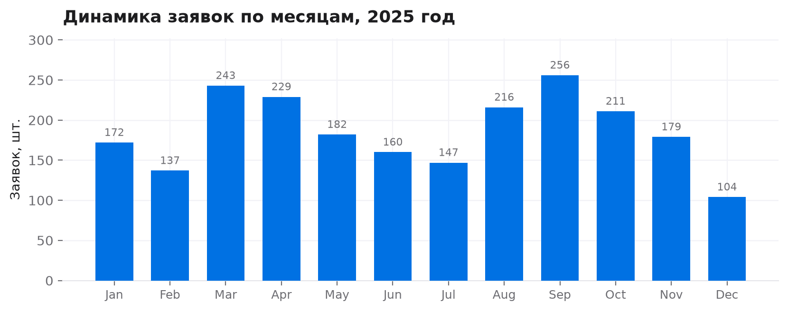

<p class="fig-caption">Рис. 1. Динамика заявок по месяцам, 2025 год</p>

**Категории.** Самая массовая категория — IT-оборудование (18,6%), почти столько же занимает канцелярия (18,5%). Вместе они дают 37,1% всех заявок, но только 27,8% суммы: это много мелких закупок. По деньгам лидируют услуги подрядчиков (199,3 млн ₽, 27,2%), IT-оборудование (155,8 млн ₽) и транспорт (91,4 млн ₽); четыре крупнейшие категории дают 72,0% объёма затрат.

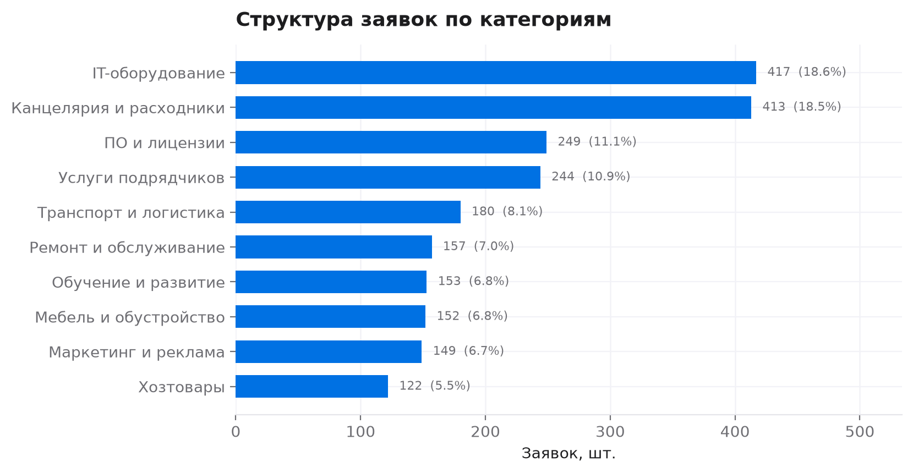

<p class="fig-caption">Рис. 2. Структура заявок по категориям после очистки</p>

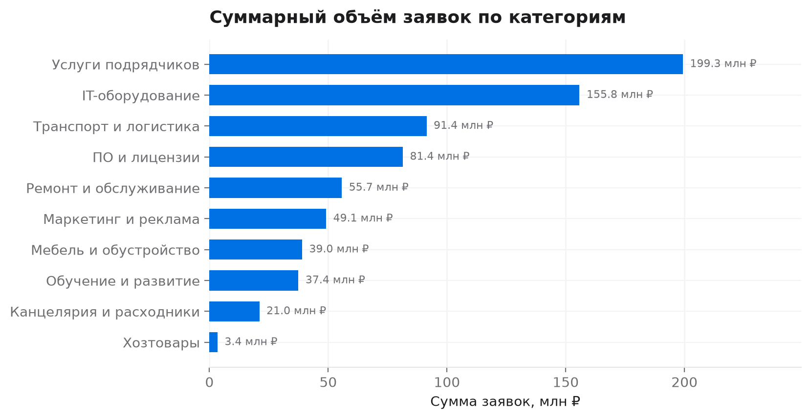

<p class="fig-caption">Рис. 3. Суммарный объём заявок по категориям, млн ₽</p>

**Суммы заявок.** Распределение сильно смещено вправо: медиана 186 776 ₽, среднее 328 107 ₽, 90-й перцентиль 779 900 ₽, 95-й — 1 252 409 ₽, максимум — 6,47 млн ₽. 19,1% заявок превышают 500 тыс. ₽, 6,8% — 1 млн ₽. Практический вывод: пороги 100 тыс., 500 тыс. и 1 млн ₽ действительно делят поток на разные по трудоёмкости группы, а среднее нельзя использовать как «типичную заявку» — только медиану.

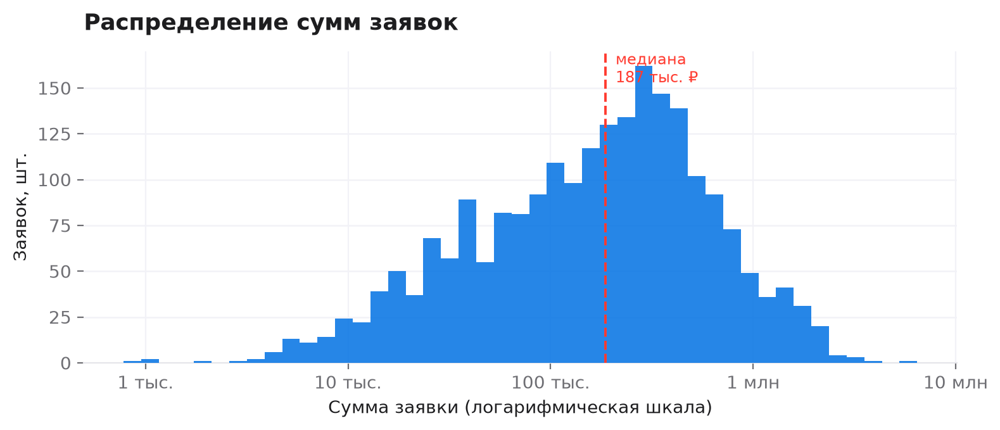

<p class="fig-caption">Рис. 4. Распределение сумм заявок (логарифмическая шкала)</p>

**Статусы.** Одобрено 54,3% заявок, в работе — 20,8%, возвращено на доработку — 13,7%, отклонено — 7,2%, отменено — 4,0%. Возвраты — не редкость, а системная часть процесса.

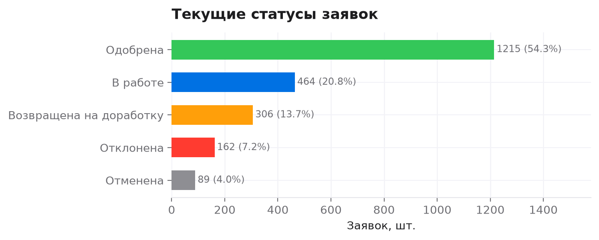

<p class="fig-caption">Рис. 5. Текущие статусы заявок</p>

**Сроки обработки.** Средний срок — 4,88 дня, медиана — 4,4, 90-й перцентиль — 7,8. Срочные заявки обрабатываются быстрее (3,45 дня), плановые — медленнее (5,73). Разница между одобренными (4,58) и возвращёнными (7,17) — 2,6 дня; это и есть цена одного возврата.

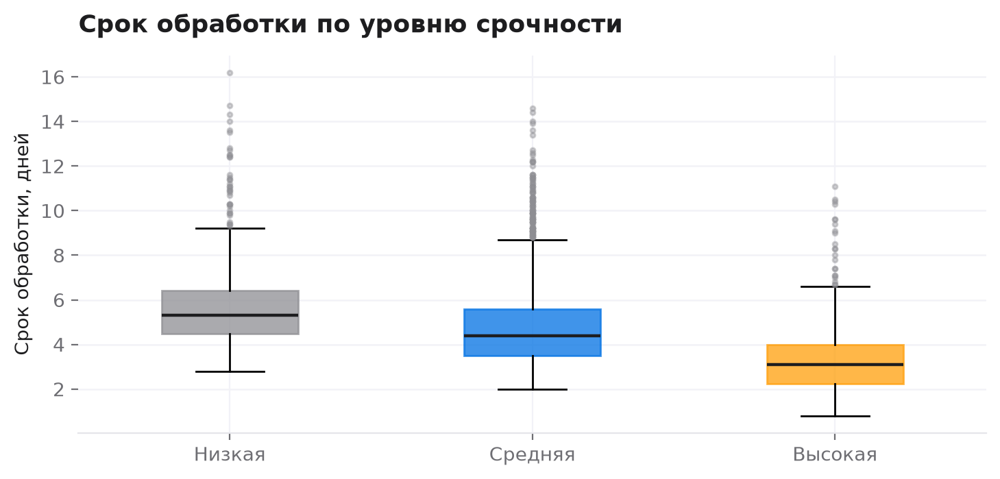

<p class="fig-caption">Рис. 6. Срок обработки по уровню срочности</p>

**Полнота заявок.** Средний индекс полноты — 0,878; у 11,5% заявок он ниже 0,7. Полнота слабо связана со сроком (ρ = −0,04), но заметнее — с фактом возврата (ρ = −0,15): неполные заявки чаще возвращаются, хотя связь и не определяет исход полностью.

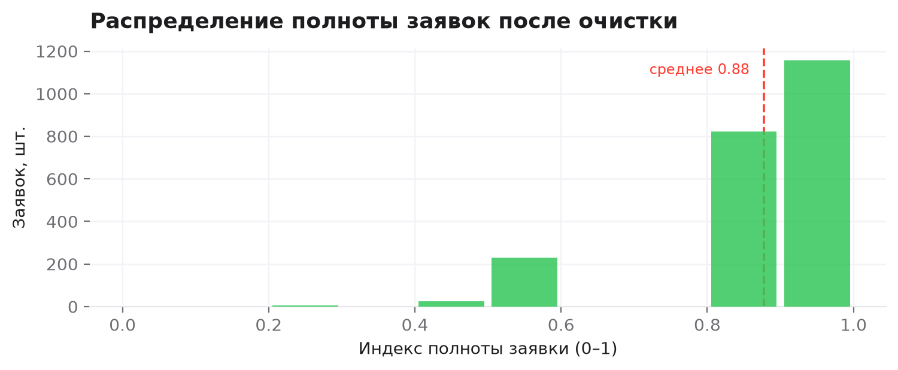

<p class="fig-caption">Рис. 7. Распределение полноты заявок после очистки</p>

**Пропуски.** До очистки бюджетный код отсутствовал в 17,2% заявок, цена — в 5,8%, количество — в 5,0%, срочность — в 4,4%. После очистки структурные пропуски закрыты, а обоснование сознательно не восстановлено: пустой текст нельзя придумывать, его нужно запрашивать у заявителя.

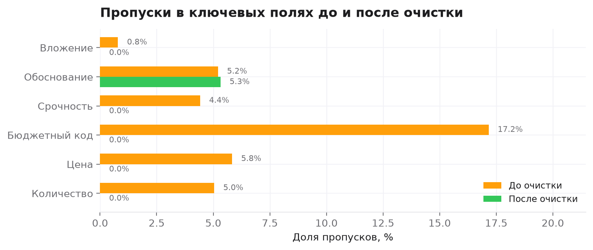

<p class="fig-caption">Рис. 8. Пропуски в ключевых полях до и после очистки</p>

**Таблица 5.** Ключевые метрики разведочного анализа

| Метрика | Значение |
|---|---|
| Заявок после очистки | 2 236 |
| Суммарный объём | 733,6 млн ₽ |
| Медиана / среднее суммы | 186 776 ₽ / 328 107 ₽ |
| P90 / P95 суммы | 779 900 ₽ / 1 252 409 ₽ |
| Заявки ≥ 500 тыс. ₽ / ≥ 1 млн ₽ | 19,1% / 6,8% |
| Средний срок обработки | 4,88 дня |
| Доля возвратов | 13,7% |
| Срок возвращённых / одобренных | 7,17 / 4,58 дня |
| Средняя полнота | 0,878 |
| Поставщик не указан | 57,6% |

### 3.4 Выводы по данным

Данных достаточно для трёх задач: обучения классификатора категорий, поиска дубликатов и настройки правил маршрутизации. Для них важны текст, сумма, категория, подразделение и статус — все эти поля есть и имеют приемлемое качество после очистки.

Данных **недостаточно** для трёх других задач: рыночного бенчмаркинга цен (нет внешних прайсов), оценки поставщиков (нет истории договоров и исполнения) и прогнозирования согласования (нет признаков, которые не были бы заложены генератором). Эти задачи в проект не включены, чтобы не выдавать синтетические закономерности за найденные.

Корреляции в данных слабые: полнота объясняет лишь малую часть вариации срока и возврата. Это нормально для процесса, где решение зависит от людей, бюджета и категории. Поэтому в решении нет прогнозной модели «одобрят/не одобрят» — есть правила, которые проверяют факты, и человек, который принимает решение.

## 4. Этап 3. Подготовка данных

### 4.1 Карта проблем качества

**Таблица 6.** Найденные проблемы и способы их устранения

| Проблема | Пример | Масштаб | Решение |
|---|---|---|---|
| Разные форматы дат | `2025-03-08`, `08.03.2025`, `08/03/2025`, `45937` | 4 формата | Явный парсер, Excel-serial |
| Разные форматы денег | `348 190,29 руб.`, `348190.29`, `348190.29 RUB` | весь набор | Единый парсер |
| Варианты справочника категорий | `IT`, `ит-оборудование`, `Оборудование IT` | 317 строк | Словарь соответствий |
| Варианты подразделений | `HR`, `Кадры`, `отдел кадров` | 184 строки | Словарь соответствий |
| Точные дубликаты | Совпадение всех полей, кроме ID | 68 | Удаление |
| Почти дубликаты | Другой заявитель и дата, тот же текст | 96 | Удаление по правилу |
| Остаточные похожие пары | Тот же предмет, другой контекст | 68 | Флаг для человека |
| Пропуски | Нет цены, бюджета, срочности | 121–412 | Импутация / флаг |
| Отрицательные значения | `−5 шт.`, `−12 000 ₽` | 13 | Замена на медиану |
| Выбросы | Цена в 10 раз выше категории | 148 | Флаг + winsorization |
| Валютные заявки | 34 USD, 30 EUR | 64 | Курс к рублю |
| Рассогласование суммы | `qty × price ≠ total` | 347 | Пересчёт |
| Короткое обоснование | «нужно», «срочно», пусто | 619 | Флаг, без импутации |
| Поставщик не указан | `Не указан` | 1 391 | Отдельный признак |

### 4.2 Форматы, типы и валюты

Даты приводятся к типу `datetime` четырьмя парсерами; нечитаемых дат не осталось. Деньги очищаются от пробелов, обозначений «руб.»/«RUB» и запятых-разделителей, после чего приводятся к `float`. Валюта фиксируется в отдельном поле `currency_original`, а сумма пересчитывается в рубли по допущениям проекта: 92,5 ₽ за USD и 100,5 ₽ за EUR. Курс не исторический, а фиксированный — это упрощение, которое в промышленной системе заменяется курсом на дату заявки.

Отдельно исправлена ошибка, которая сначала искажала данные: при очистке строки «220 337,33 руб.» регулярное выражение оставляло точку после «руб», и сумма вырастала в 100 раз. После исправления парсера максимальная сумма снизилась с 220 млн ₽ до 6,47 млн ₽ — это иллюстрация того, почему очистку нужно проверять на правдоподобие результата, а не только на отсутствие ошибок.

### 4.3 Нормализация справочников

Категории и подразделения приводятся к каноническим значениям через словарь: `IT`, `ит-оборудование`, `Оборудование IT` → `IT-оборудование`; `HR`, `Кадры`, `отдел кадров` → `Отдел кадров`. Всего нормализовано 317 вариантов категорий и 184 варианта подразделений. Неопознанных категорий после нормализации нет; неопознанные подразделения сохраняются как есть с пометкой, чтобы не терять данные.

Срочность сводится к трём уровням: `низкая`, `средняя`, `высокая`. Варианты `Срочно`, `ASAP`, `критично` → `высокая`; `плановая`, `не срочно` → `низкая`. Пропуски срочности заполняются значением `средняя`, но флаг `urgency_missing` сохраняется — иначе решение потеряет информацию о том, что поле не заполнял человек.

Единицы измерения нормализуются частично: `шт`, `ШТ.`, `ед.` → `шт.`. Полная унификация единиц не делается, потому что разные категории используют разные шкалы (`л`, `мес.`, `услуга`, `проект`), и приведение их к одной единице бессмысленно.

### 4.4 Дубликаты

Дубликаты искались в два прохода.

**Точные.** Совпадение всех полей, кроме `request_id`. Удалено 68 строк. Это заявки, которые повторно выгрузились из системы или были скопированы вручную.

**Почти дубликаты.** Кандидаты сравнивались внутри группы «подразделение + категория» при трёх условиях: разница дат не больше 10 дней, разница сумм не больше 5%, сходство нормализованных текстов не меньше 0,88 (SequenceMatcher). Удалено 96 строк. Порог выбран консервативно: при 0,88 тексты отличаются лишь служебными словами и порядком характеристик.

**Остаточные пары.** После удаления осталось 68 пар, похожих на дубликаты, но не проходящих порог (сходство 0,85–0,88 либо сумма отличается на 5–15%). Они **не удалены**, а помечены полями `possible_duplicate` и `duplicate_of`. Причина: ложное удаление реальной заявки дороже, чем ручная проверка одной пары. В промышленной системе такие пары должны попадать в очередь на подтверждение закупщиком.

Алгоритм квадратичен внутри группы, но при 2 400 строках и 10 категориях работает за секунды. При объёме от 100 тыс. заявок нужен блокинг по категории и приближённый поиск (TF-IDF + ANN), иначе сложность станет узким местом.

### 4.5 Пропуски и импутация

**Таблица 7.** Пропуски до и после очистки

| Поле | До, шт. | До, % | После, шт. | После, % | Решение |
|---|---:|---:|---:|---:|---|
| Количество | 121 | 5,0 | 0 | 0,0 | Медиана по категории |
| Цена за единицу | 140 | 5,8 | 0 | 0,0 | Медиана по категории и единице |
| Бюджетный код | 412 | 17,2 | 0 | 0,0 | Значение «НЕ УКАЗАН» |
| Срочность | 106 | 4,4 | 0 | 0,0 | «средняя» + флаг |
| Обоснование | 125 | 5,2 | 119 | 5,3 | Не импутируется |
| Вложение | 19 | 0,8 | 0 | 0,0 | «нет» |

Импутация выполняется медианой, а не средним: распределение сумм и цен скошено, среднее смещается в сторону крупных закупок. Медиана считается внутри категории (для цены — внутри пары «категория + единица»), потому что цена ноутбука и цена ручки несопоставимы. Каждая импутация помечается флагом `qty_imputed` или `price_imputed`, чтобы аналитик мог исключить восстановленные значения из чувствительных расчётов.

Бюджетный код не восстанавливается: «НЕ УКАЗАН» — это сигнал для проверки, а не пропуск для заполнения. Обоснование тоже не генерируется: придуманное обоснование хуже отсутствующего, потому что выглядит достоверным. Для него считается флаг `justification_short` (короче 30 символов).

### 4.6 Выбросы и согласование сумм

Выбросы определялись методом межквартильного размаха внутри категории: границы `Q1 − 1,5·IQR` и `Q3 + 1,5·IQR`. Помечено 148 цен. Они не удалены: дорогая заявка может быть реальной (сервер, ремонт кровли), и удаление исказило бы объём закупок. Для описательной статистики создана winsorized-версия `unit_price_winsorized` (обрезка по 1-му и 99-му перцентилям), а для решений используется исходная цена с флагом аномалии.

Сумма пересчитывается как `quantity × unit_price`; расхождение более 2% с исходным значением зафиксировано в 347 случаях. Исходная сумма заменяется расчётной, а флаг `total_recalculated` остаётся. Это важно для экономики: если доверять исходной сумме, объём закупок искажается на десятки процентов.

### 4.7 Производные признаки и преобразования

**Таблица 8.** Добавленные признаки

| Признак | Что означает | Зачем |
|---|---|---|
| `month`, `quarter`, `weekday` | Календарные признаки | Анализ сезонности |
| `text_len`, `justification_len` | Длина текста | Прокси информативности |
| `amount_log` | `log(1 + сумма)` | Снижение скошенности |
| `price_per_unit` | Сумма / количество | Сравнение с медианой |
| `is_high_value` | Сумма ≥ 500 тыс. ₽ | Пороговое правило |
| `is_urgent` | Срочность = высокая | Приоритизация |
| `lead_time_bucket` | Корзины срока | Описательная статистика |
| `completeness_score` | Доля заполненных полей на входе | Маршрутизация |
| `price_outlier` | Вне IQR категории | Проверка цены |
| `possible_duplicate` / `duplicate_of` | Ссылка на похожую заявку | Ручная проверка |

Для текста используется **TF-IDF** (униграммы и биграммы, 9 000 признаков, sublinear TF) — это и есть кодирование категориальных по смыслу признаков. Label Encoding и one-hot для текста не применяются: они превратили бы 2 000 уникальных формулировок в 2 000 разреженных колонок без обобщения. Масштабирование числовых признаков не требуется: логистическая регрессия обучена на TF-IDF, где все признаки уже нормированы, а правила работают с исходными рублями.

Числовые признаки не масштабировались и для правил — пороги заданы в рублях и должны читаться человеком. Это сознательный отказ от «красивой» нормализации в пользу объяснимости.

### 4.8 Сравнение «до» и «после»

**Таблица 9.** Итог подготовки данных

| Характеристика | Исходный набор | Подготовленный набор |
|---|---|---|
| Строк | 2 400 | 2 236 |
| Признаков | 20 | 43 |
| Дубликаты | 164 (6,8%) | 0 + 68 флагов |
| Пропуски в структурных полях | до 17,2% | 0% |
| Категории | 40+ вариантов написания | 10 канонических |
| Подразделения | 40+ вариантов | 14 канонических |
| Даты | 4 формата | `datetime` |
| Суммы | текст в 4 форматах | `float`, руб. |
| Рассогласование суммы | 347 | 0 (флаг сохранён) |
| Выбросы | не выделены | 148 флагов |
| Валюты | RUB / USD / EUR | RUB + исходная валюта |

Подготовленный набор лучше подходит для решения не потому, что в нём «меньше строк», а потому, что каждое поле имеет один тип, одно значение и один смысл. Классификатор обучается на 2 236 текстах без дубликатов, правила сравнивают суммы в одной валюте, а флаги сохраняют историю вмешательства — аналитик всегда может отличить измеренное значение от восстановленного.

## 5. Этап 4. Проектирование решения и команды

### 5.1 Логика работы решения

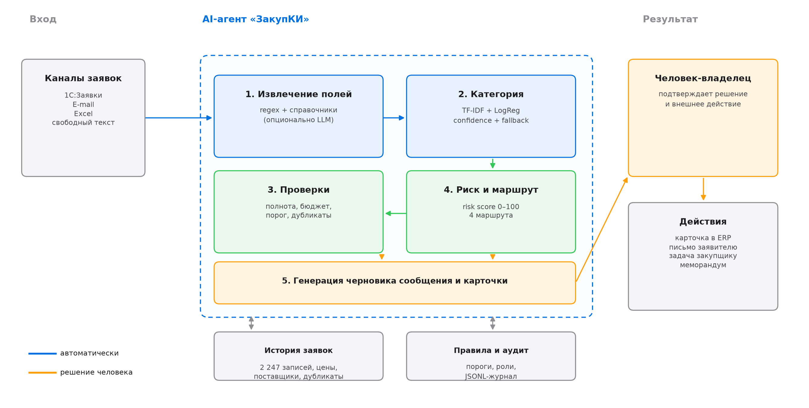

<p class="fig-caption">Рис. 9. Архитектура агента «ЗакупКИ» и роль человека</p>

Решение состоит из пяти шагов, каждый из которых имеет чёткий вход и выход.

**Таблица 10.** Поток обработки заявки

| Шаг | Вход | Выход | Автоматизация |
|---|---|---|---|
| 1. Извлечение | Текст заявки, поля формы | 12 структурированных полей | Полная, с флагом низкой уверенности |
| 2. Классификация | Текст, предмет | Категория + уверенность | Полная |
| 3. Проверки | Поля, история, правила | 11 проверок со статусами | Полная |
| 4. Риск и маршрут | Проверки, сумма, дубликат | Балл 0–100, маршрут | Полная |
| 5. Черновик и аудит | Всё выше | Письмо, карточка, JSONL | Полная, без отправки |

Ключевое проектное решение: **агент не принимает решений, а готовит их**. Он снижает стоимость проверки, но не отменяет её. Поэтому в архитектуре нет шага «отправить», есть шаг «подготовить черновик и записать аудит».

### 5.2 Обоснование технологического подхода

**Таблица 11.** Сравнение вариантов

| Подход | Что даёт | Где ломается | Роль в решении |
|---|---|---|---|
| Обычная автоматизация | Формы, обязательные поля, пороги | Не работает со свободным текстом и дублями по смыслу | Основа: правила и маршруты |
| Классическое ML | Устойчивая категория, калиброванная уверенность | Требует размеченных данных, не объясняет «почему» | Классификатор категорий |
| Генеративный ИИ | Понимает язык, пишет текст | Дорого, нестабильно, риск галлюцинаций | Опционально: нормализация и черновики |
| AI-агент | Комбинирует инструменты, ведёт процесс | Сложнее тестировать, нужен контроль | Оркестрация всего сценария |

Выбран **гибридный AI-агент**: правила отвечают за политику, ML — за категорию, TF-IDF — за дубликаты, шаблоны — за черновик. Генеративная модель не обязательна для работы: прототип полностью офлайн и детерминирован. В промышленной версии LLM подключается как заменяемый адаптер для двух задач — извлечения полей из сложных текстов и формулировки писем; правила и маршрутизация остаются прежними.

Такое разделение даёт три свойства, важных для закупок: **объяснимость** (каждое решение ссылается на проверку), **воспроизводимость** (одинаковый вход даёт одинаковый выход) и **контролируемую стоимость** (токены тратятся только там, где нужен язык).

### 5.3 «Суперкот»

«Суперкот» — идеальный исполнитель роли первичной обработки закупочных заявок. Его цель: **за минимальное время довести любую заявку до состояния, в котором человек может принять решение, не перепроверяя исходные данные**.

**Таблица 12.** Способности «суперкота»

| Способность | Зачем | Как проверяется |
|---|---|---|
| Читать свободный текст | 40% заявок не имеют полной формы | Точность извлечения на размеченной выборке |
| Знать справочники | Категории и отделы написаны по-разному | Доля нормализованных записей |
| Считать полноту | Возвраты стоят 2,6 дня | Сравнение с чек-листом закупщика |
| Искать дубликаты | 6,8% заявок повторяются | Precision / recall на парах |
| Применять политику | Пороги и правила разбросаны по документам | Совпадение с решением эксперта |
| Оценивать риск | Нужна приоритизация внимания | Калибровка балла |
| Объяснять решение | Человек должен доверять маршруту | Наличие основания у каждого флага |
| Писать черновик | Экономия времени на переписку | Доля писем, принятых без правок |
| Вести аудит | Требование ИБ и разбор инцидентов | Полнота журнала |

**Инструменты «суперкота»:** 1С:Заявки (чтение), справочники категорий и подразделений, реестр поставщиков, история заявок и цен, политика закупок, почтовый шлюз (только черновик), журнал аудита.

**Ограничения «суперкота»:** не отправляет сообщения без подтверждения, не принимает финансовых решений, не работает с персональными данными без обезличивания, не выдаёт решение без объяснения, останавливается при низкой уверенности.

### 5.4 «Суперкоманда»

**Таблица 13.** Роли и зоны ответственности

| Роль | Компетенции | Зона ответственности | Загрузка |
|---|---|---|---|
| Владелец продукта (руководитель закупок) | Процессы закупок, политика | Приоритеты, приёмка, границы автоматизации | 30 ч |
| AI-инженер | Python, NLP, ML, LLM | Архитектура, агент, интеграция модели | 200 ч |
| Аналитик данных | Pandas, статистика, визуализация | Данные, очистка, EDA, метрики | 50 ч |
| Эксперт-закупщик | Категории, цены, поставщики | Правила, эталонные ответы, приёмка | 40 ч |
| Проектный менеджер | Планирование, коммуникации | Сроки, риски, отчёты | 30 ч |
| QA / тестировщик | Тест-дизайн, сценарии | Проверка сценариев и регрессий | 30 ч |
| Специалист ИБ | 152-ФЗ, модели угроз | Оценка данных, режим LLM, аудит | 20 ч |
| Интегратор 1С | API, справочники | Чтение заявок, создание черновика карточки | 60 ч |
| Юрист | Договоры, закупочные пороги | Проверка формулировок и дисклеймеров | 12 ч |
| Change-менеджер | Обучение, коммуникации | Обучение закупщиков, обратная связь | 20 ч |

Итого около 492 часов. В экономической модели учтены 370 часов разработки и внедрения; интеграция 1С и юридическая проверка вынесены в разовые затраты отдельными строками, чтобы не смешивать разработку модели и ИТ-работы.

Ключевое правило команды: **эксперт-закупщик утверждает правила, а не инженер**. Инженер может предложить порог, но ответственность за его смысл лежит на владельце процесса.

### 5.5 Что автоматизируется, а что остаётся человеку

**Таблица 14.** Распределение решений

| Действие | Агент | Человек | Почему |
|---|---|---|---|
| Извлечение полей | Да | Проверяет при низкой уверенности | Ошибка исправима, но влияет на сумму |
| Категория | Да | Подтверждает при confidence < 0,45 | Категория определяет процедуру |
| Проверка полноты | Да | Запрашивает данные | Агент не ведёт переписку сам |
| Поиск дубликатов | Да | Решает, объединять ли | Ложное объединение необратимо |
| Проверка бюджета | Справочно | Подтверждает | Финансовая ответственность |
| Пороговая процедура | Маршрутизирует | Проводит процедуру | Требуется по регламенту |
| Отправка письма | Черновик | Отправляет | Внешнее действие |
| Создание карточки в ERP | Черновик | Подтверждает | Запись в учётную систему |
| Отклонение заявки | Нет | Решает | Управленческое решение |
| Выбор поставщика | Нет | Решает | Коммерческое решение |

Принцип: **чем необратимее действие и чем выше сумма, тем обязательнее человек**. Автоматическое принятие карточки в прототипе означает лишь «данные достаточно полны», а не «закупка разрешена».

### 5.6 Метрики качества решения

**Таблица 15.** Целевые метрики пилота

| Метрика | Целевое значение | Как измеряется |
|---|---|---|
| Точность категории | ≥ 0,90 macro-F1 | Размеченная выборка 300 заявок |
| Precision поиска дубликатов | ≥ 0,95 | Ручная проверка всех срабатываний |
| Доля заявок без правок полей | ≥ 60% | Сравнение карточки с эталоном |
| Доля автоматической маршрутизации | ≥ 85% | Журнал маршрутов |
| Возвраты на доработку | ≤ 8% | Статусы за 3 месяца |
| Время первичной обработки | ≤ 12 мин | Хронометраж |
| Доля переопределений маршрута человеком | ≤ 15% | Аудит |

## 6. Этап 5. Прототип AI-агента

### 6.1 Что реализовано

Прототип написан на Python 3.13 и работает полностью офлайн, без API-ключей и внешних сервисов. Это осознанное решение: демонстрация должна быть воспроизводимой на любом компьютере, а не зависеть от доступности модели и тарифа.

**Таблица 16.** Модули прототипа

| Модуль | Назначение |
|---|---|
| `agent/schema.py` | Структуры данных: заявка, проверка, результат |
| `agent/extractor.py` | Извлечение полей регулярками и справочниками |
| `agent/classifier.py` | TF-IDF + логистическая регрессия, keyword-fallback |
| `agent/duplicates.py` | Поиск дубликатов по косинусному сходству |
| `agent/policy.py` | 11 проверок, риск-балл, маршрутизация |
| `agent/agent.py` | Оркестрация, черновик, аудит |
| `agent/cli.py` | Командный интерфейс и демонстрация |

Тесты: `python -m unittest discover -s tests -v` — 9 из 9 проходят. Они покрывают извлечение полей, классификацию, маршрутизацию, поиск дубликатов и запрет внешних действий.

### 6.2 Основной сценарий

Запуск демонстрации:

```bash
python -m agent.cli --demo
```

Агент читает `examples/requests.json`, обрабатывает семь заявок и сохраняет три файла: `demo_output/demo_console.txt` (консольный вывод), `demo_output/demo_results.json` (структурированные результаты) и `demo_output/audit_log.jsonl` (журнал аудита). Обработка одной заявки текстом:

```bash
python -m agent.cli --text "Нужен ноутбук Lenovo ThinkPad, 2 шт., 190 000 руб., бюджет IT-2025-04, обоснование: замена вышедшего из строя."
```

Сценарий внутри агента: извлечение → полнота → категория → дубликат → проверки → риск → маршрут → черновик → аудит. Каждый шаг детерминирован: одинаковый вход даёт одинаковый выход и одинаковый `audit_id`.

### 6.3 Демонстрация на примерах

**Таблица 17.** Результаты обработки семи заявок

| Заявка | Сценарий | Категория (уверенность) | Маршрут | Риск | Основание |
|---|---|---|---|---|---|
| REQ-DEMO-001 | Ноутбуки, 850 тыс. ₽ | IT-оборудование (0,72) | REVIEW | 27 | Сумма > 500 тыс. ₽ → конкурентная процедура |
| REQ-DEMO-002 | Бумага, нет суммы и бюджета | Канцелярия (0,65) | CLARIFY | 67 | 3 обязательных поля отсутствуют |
| REQ-DEMO-003 | ИБП, копия заявки 2025 года | IT-оборудование (0,87) | MANAGER | 49 | Дубликат REQ-2025-02172, сходство 1,00 |
| REQ-DEMO-004 | Клининг, 1,2 млн ₽ | Услуги подрядчиков (0,65) | MANAGER | 35 | Сумма > 1 млн ₽ → закупочный комитет |
| REQ-DEMO-005 | Канцелярия, 12 тыс. ₽ | Канцелярия (0,65) | AUTO | 9 | Полные данные, порог не превышен |
| REQ-DEMO-006 | «Детали обсудим на встрече» | Не определено (0,20) | CLARIFY | 85 | 5 полей отсутствуют, низкая уверенность |
| REQ-DEMO-007 | Ремонт погрузчика, 145 тыс. ₽ | Ремонт и обслуживание (0,82) | REVIEW | 11 | Сумма > 100 тыс. ₽ → 3 предложения |

Обратите внимание на REQ-DEMO-001: риск всего 27 из 100, но маршрут — проверка закупщиком. Это не ошибка, а принцип: **маршрут определяется не только баллом, но и пороговым правилом**. Нельзя автоматически принимать заявку на 850 тыс. ₽ только потому, что она хорошо заполнена.

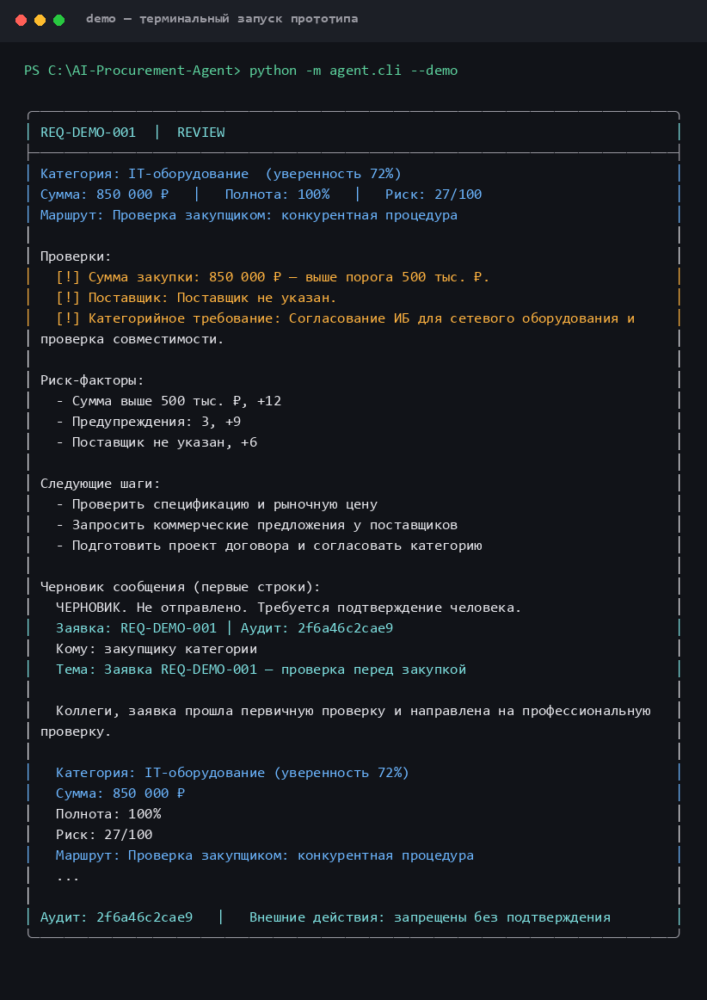

<p class="fig-caption">Рис. 10. Заявка REQ-DEMO-001: полные данные, но сумма выше порога конкурентной процедуры</p>

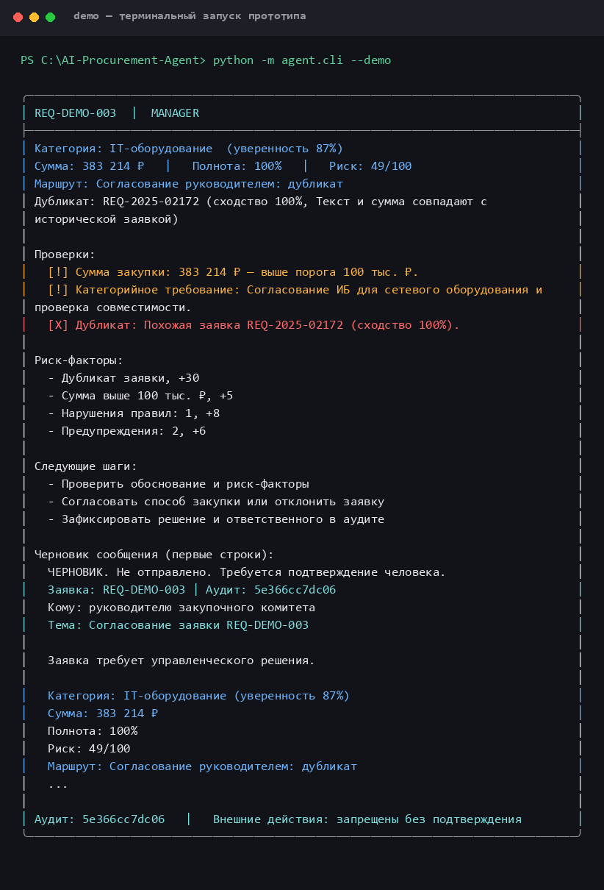

<p class="fig-caption">Рис. 11. Заявка REQ-DEMO-003: найден дубликат, решение уходит руководителю</p>

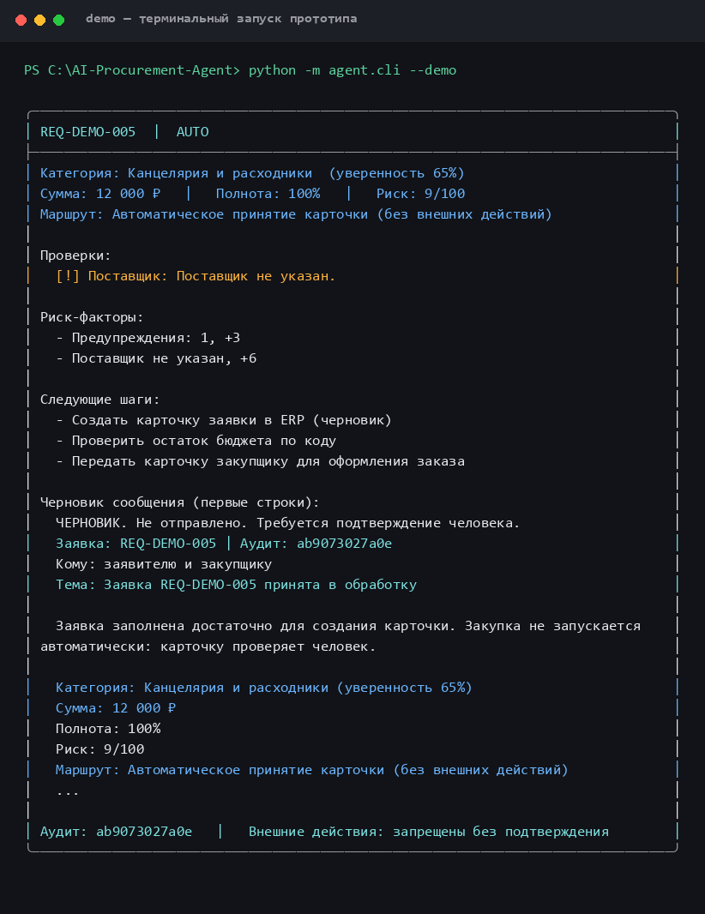

<p class="fig-caption">Рис. 12. Заявка REQ-DEMO-005: полные данные и низкая сумма — автоматическое принятие карточки</p>

Даже в маршруте AUTO агент не выполняет внешних действий: он формирует карточку и черновик, а решение остаётся за человеком.

### 6.4 Классификатор категорий

Модель: TF-IDF (униграммы и биграммы, до 9 000 признаков) + логистическая регрессия с балансировкой классов. Выборка разделена стратифицированно: 1 677 заявок на обучение, 559 на тест.

**Таблица 18.** Метрики классификатора

| Метрика | Значение |
|---|---|
| Accuracy | 0,9463 |
| Macro-F1 | 0,9409 |
| Weighted-F1 | 0,9492 |
| Baseline (мажоритарный класс) | 0,186 |
| Кросс-валидация, macro-F1 | 0,9432 ± 0,0129 |

**Таблица 19.** Качество по категориям (тестовая выборка)

| Категория | Precision | Recall | F1 | Поддержка |
|---|---:|---:|---:|---:|
| IT-оборудование | 1,000 | 0,971 | 0,985 | 104 |
| Канцелярия и расходники | 1,000 | 0,942 | 0,970 | 103 |
| ПО и лицензии | 1,000 | 0,952 | 0,976 | 63 |
| Услуги подрядчиков | 0,809 | 0,902 | 0,853 | 61 |
| Транспорт и логистика | 1,000 | 0,911 | 0,953 | 45 |
| Ремонт и обслуживание | 1,000 | 0,923 | 0,960 | 39 |
| Обучение и развитие | 0,946 | 0,921 | 0,933 | 38 |
| Мебель и обустройство | 1,000 | 0,947 | 0,973 | 38 |
| Маркетинг и реклама | 1,000 | 1,000 | 1,000 | 37 |
| Хозтовары | 0,674 | 1,000 | 0,805 | 31 |

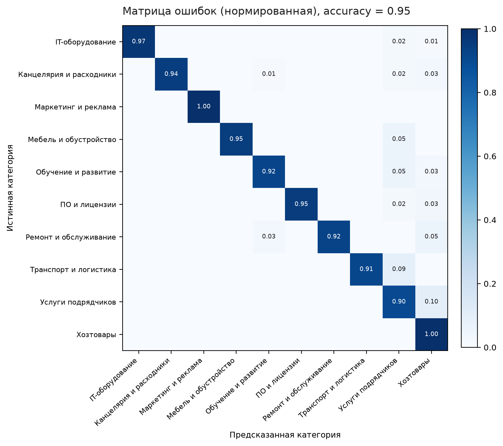

<p class="fig-caption">Рис. 13. Нормированная матрица ошибок классификатора</p>

Слабейшая категория — «Хозтовары»: низкая precision (0,674) означает, что в неё попадают заявки из других категорий, в первую очередь из канцелярии. Причина в лексике: «мыло», «мешки», «перчатки» соседствуют с бытовой химией и расходниками. Вторая проблемная пара — «Услуги подрядчиков» и «Ремонт и обслуживание»: и там и там встречается слово «услуга».

**Важная оговорка.** Точность 0,946 — оптимистичная оценка. Тексты синтетические и построены по шаблонам; единицы измерения (`шт`, `лиц`, `мес`) почти однозначно указывают на категорию. На реальных заявках с опечатками, смешанными формулировками и неполными описаниями ожидаемая точность — 0,75–0,85. Поэтому в промышленной версии нужны: размеченная реальная выборка, регулярная переоценка и активное обучение на ошибках.

### 6.5 Правила, риск и маршруты

**Таблица 20.** Проверки агента

| Код | Что проверяет | Вес в риске |
|---|---|---|
| REQ-01 | Полнота обязательных полей | До 28 |
| BUD-01 | Формат и наличие бюджетного кода | 8 |
| JUS-01 | Содержательность обоснования (≥ 30 символов) | 3 |
| AMT-01 | Порог 100 тыс. / 500 тыс. / 1 млн ₽ | 5 / 12 / 18 |
| SUP-01 | Указан ли поставщик | 6 |
| URG-01 | Срочность без обоснования | 10 |
| CAT-01 | Категорийное требование (ИБ, юрист, техэкспертиза) | 3 |
| DUP-01 | Точный или возможный дубликат | 12 / 30 |
| PRICE-01 | Отклонение цены от медианы более чем в 3 раза | 8 |
| DATE-01 | Желаемый срок в прошлом или менее 3 дней | 8 |
| CLS-01 | Уверенность классификатора ниже 0,45 | 18 |

Балл риска суммируется и ограничивается 100. Маршрут выбирается по приоритету: дубликат → руководитель; пропуски или критичное нарушение → уточнение; сумма ≥ 1 млн ₽ → руководитель; ≥ 500 тыс. ₽ → проверка закупщиком; ≥ 100 тыс. ₽ или категорийное требование → проверка закупщиком; иначе — по баллу: ≥ 80 руководитель, ≥ 55 закупщик, ≥ 30 уточнение, иначе авто-карточка.

Пороговые правила имеют приоритет над баллом. Это защищает от ситуации «заявка на 5 млн ₽ с идеальным обоснованием ушла в авто».

### 6.6 Человеческий контроль и аудит

Контроль встроен в архитектуру, а не добавлен сверху:

- Поле `external_action_allowed` всегда `False`; изменить его через CLI нельзя.
- Любое сообщение начинается с «ЧЕРНОВИК. Не отправлено. Требуется подтверждение человека.»
- Флаг `--confirm-send` не отправляет письмо, а лишь пишет в консоль, что подтверждение зафиксировано; прототип не имеет почтового транспорта.
- Каждая обработка пишет запись в `demo_output/audit_log.jsonl` с `audit_id`, маршрутом, проверками, риском и факторами.

Пример аудит-записи (сокращён):

```json
{
  "request_id": "REQ-DEMO-003",
  "audit_id": "e1b7c0d5a3f2",
  "category": "IT-оборудование",
  "category_confidence": 0.87,
  "risk_score": 49,
  "route": "manager_approval",
  "duplicate": {"is_duplicate": true, "request_id": "REQ-2025-02172",
                 "similarity": 1.0},
  "policy_checks": [{"code": "DUP-01", "status": "fail",
                      "detail": "Похожая заявка REQ-2025-02172 (сходство 100%)."}],
  "human_review_required": true,
  "external_action_allowed": false
}
```

Аудит решает три задачи: разбор инцидента (почему заявка ушла в авто), контроль качества (сколько маршрутов переопределил человек) и требования ИБ (кто и на основании чего видел данные).

### 6.7 Ограничения прототипа

- **Офлайн-извлечение.** Регулярные выражения хрупки: сложная формулировка с несколькими позициями в одной заявке разбирается частично.
- **Категория только по тексту.** Подразделение и история закупок не используются как признаки.
- **Лексические дубликаты.** TF-IDF не находит перефразирования («ИБП» ↔ «блок бесперебойного питания»); нужен embedding-поиск.
- **Правила зашиты в код.** В промышленной версии пороги должны быть конфигурируемыми и версионируемыми.
- **Нет интеграции.** Прототип не читает 1С и не пишет карточки; это демонстрация логики.
- **Нет разграничения доступа.** Один локальный пользователь, без аутентификации и ролей.
- **Русский язык.** Модель не проверялась на других языках и на смешанных текстах.

## 7. Этап 6. Экономика и внедрение

### 7.1 Допущения модели

Все расчёты выполнены скриптом `scripts/economics.py` и сохранены в `reports/economics.json` и `reports/economics_table.csv`. Значения — оценки, а не факты; каждое помечено как допущение, требующее проверки.

**Таблица 21.** Исходные допущения

| Параметр | Значение | Статус |
|---|---|---|
| Объём заявок в год | 2 247 | Факт по очищенным данным |
| Время обработки до | 35 мин | Допущение, нужен хронометраж |
| Время обработки после | 12 мин | Допущение по пилоту |
| Стоимость часа с накладными | 1 200 ₽ | Допущение (≈ 200 тыс. ₽/мес) |
| Входные токены на вызов | 1 900 | Допущение |
| Выходные токены на вызов | 500 | Допущение |
| Цена входа | 45 ₽ / 1 млн токенов | Допущение |
| Цена выхода | 180 ₽ / 1 млн токенов | Допущение |
| Вызовов на заявку | 1,7 | Допущение (извлечение + черновик) |
| Embedding-токены на заявку | 600 | Допущение |
| Цена embedding | 8 ₽ / 1 млн | Допущение |
| Доля возвратов до / после | 13,7% / 8,0% | Факт / цель |
| Время доработки | 20 мин | Допущение |
| Доля дубликатов | 2,0% (обнаруживаемых) | Консервативно от 6,8% |
| Время на дубликат | 30 мин | Допущение |
| Ставка дисконтирования | 20% | Допущение |

Почему доля дубликатов в эффекте взята 2%, а не 6,8%: агент обнаруживает не все дубликаты, часть из них уже отсекается людьми, и экономия возникает только там, где дубликат был бы иначе пропущен. Консервативная оценка лучше завышенной.

### 7.2 Стоимость вызова модели

Формула из задания:

> Стоимость вызова = ((входные токены × цена входа за 1 млн) + (выходные токены × цена выхода за 1 млн)) / 1 000 000

Подстановка:

> ((1 900 × 45) + (500 × 180)) / 1 000 000 = (85 500 + 90 000) / 1 000 000 = **0,1755 ₽**

Стоимость обработки одной заявки с учётом 1,7 вызова и embedding-поиска:

> 0,1755 × 1,7 + (600 × 8) / 1 000 000 = 0,2984 + 0,0048 = **0,3031 ₽**

Годовые затраты на API: 0,3031 × 2 247 = **681 ₽**. Это меньше 0,1% совокупных затрат — на таком объёме стоимость токенов не является значимым фактором. Экономика решения определяется не API, а трудозатратами и внедрением.

### 7.3 Разовые и постоянные затраты

**Таблица 22.** Разовые затраты

| Статья | Сумма, ₽ |
|---|---:|
| AI-инженер, 200 ч × 2 500 ₽ | 500 000 |
| Аналитик данных, 50 ч × 1 800 ₽ | 90 000 |
| Эксперт по закупкам, 40 ч × 1 500 ₽ | 60 000 |
| Проектный менеджер, 30 ч × 2 200 ₽ | 66 000 |
| QA и пилот, 30 ч × 1 200 ₽ | 36 000 |
| Обучение и управление изменениями | 28 000 |
| **Итого разработка** | **780 000** |
| Интеграция с 1С/ERP | 120 000 |
| ИБ и оценка воздействия на данные | 60 000 |
| Документация процессов | 40 000 |
| Резерв на непредвиденные работы | 100 000 |
| **Итого внедрение** | **320 000** |
| **Всего разово** | **1 100 000** |

**Таблица 23.** Постоянные затраты в год

| Статья | Сумма, ₽/год |
|---|---:|
| Хостинг и вычислительные ресурсы | 36 000 |
| Мониторинг и observability | 24 000 |
| Поддержка и инциденты | 60 000 |
| Лицензии и инструменты | 60 000 |
| Сопровождение ИБ | 60 000 |
| API модели | 681 |
| **Итого** | **240 681** |

Статические затраты (хостинг, поддержка, лицензии, ИБ) составляют 240 тыс. ₽ в год — в 350 раз больше стоимости токенов. Это типичная картина для прикладного агента: модель дешева, сопровождение — нет.

### 7.4 Ожидаемый эффект

**Таблица 24.** Годовой эффект

| Источник | Расчёт | Сумма, ₽/год |
|---|---|---:|
| Экономия времени закупщиков | 2 247 × (23/60) × 1 200 | 1 033 620 |
| Снижение доработок | (0,137 − 0,08) × 2 247 × (20/60) × 1 200 | 60 220 |
| Обнаруженные дубликаты | 2 247 × 0,02 × (30/60) × 1 200 | 26 964 |
| **Итого** | | **1 120 804** |

Чистый годовой эффект: 1 120 804 − 240 681 = **880 122 ₽**.

Эффект считается только по подтверждаемым источникам: сэкономленное время, меньше возвратов, меньше повторных закупок. В него не включены «улучшение качества решений», «снижение закупочных цен» и «повышение удовлетворённости» — эти эффекты реальны, но не измерены, и включать их в окупаемость было бы манипуляцией.

### 7.5 Окупаемость и точка безубыточности

Окупаемость: 1 100 000 / 880 122 × 12 = **15,0 месяца**.

Вклад одной заявки: 1 120 804 / 2 247 = **498,8 ₽**.

Точка безубыточности: (1 100 000 + 240 681) / 498,8 = **2 688 заявок в год**.

Здесь важный и неудобный вывод: **2 688 больше фактического объёма 2 247**. Это значит, что при текущем потоке решение не окупает разовые и годовые затраты в пределах первого года; окупаемость наступает на 15-м месяце, то есть уже во втором году. Для окупаемости за 12 месяцев нужен либо рост объёма до ≈ 2 700 заявок, либо экономия не 23, а ≈ 28 минут на заявку, либо снижение разовых затрат.

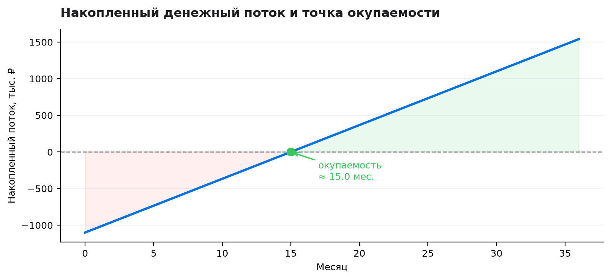

<p class="fig-caption">Рис. 14. Накопленный денежный поток и точка окупаемости</p>

За три года: ROI 140%, NPV при ставке 20% — 918 317 ₽. Проект остаётся выгодным, но не является «быстро окупаемым»: горизонт решения — два-три года.

### 7.6 Чувствительность

**Таблица 25.** Окупаемость, месяцев, в зависимости от объёма и экономии времени

| Заявок в год | 15 мин | 23 мин (база) | 30 мин |
|---:|---:|---:|---:|
| 1 500 | 49,3 | 26,0 | 18,4 |
| 2 000 | 30,2 | 17,4 | 12,7 |
| 2 247 | 25,4 | **15,0** | 11,0 |
| 3 000 | 17,0 | 10,5 | 7,9 |
| 4 000 | 11,8 | 7,5 | 5,7 |

Разброс — от 5,7 до 49,3 месяца. Критический параметр — не объём и не цена токенов, а **сэкономленное время на заявку**. Поэтому пилот должен начинаться с хронометража: если реальная экономия окажется 10–15 минут, проект нужно либо пересобирать (сильнее автоматизировать ввод), либо не масштабировать.

### 7.7 Чего не хватает для надёжной оценки

- **Хронометража процесса.** 35 и 12 минут — экспертные оценки. Нужны замеры на 100–200 заявках до и после.
- **Реальной стоимости токенов.** Цены взяты как ориентир; при смене модели или тарифа стоимость вызова может измениться в 2–5 раз (на общую экономику влияет слабо).
- **Стоимости ошибок.** Ложный дубликат, пропущенная аномалия цены, неверная категория имеют цену, но она не измерена.
- **Затрат на интеграцию.** 120 тыс. ₽ — оценка; реальная интеграция с 1С может стоить дороже.
- **Доли принятия пользователями.** Если закупщики не доверяют агенту и перепроверяют всё вручную, экономия времени исчезает.
- **Внешних цен.** Без рыночных прайсов нельзя оценить эффект от контроля цен.

### 7.8 План внедрения

**Таблица 26.** Этапы внедрения

| Этап | Срок | Содержание | Результат |
|---|---|---|---|
| 0. Подготовка | 2 недели | Согласование границ, доступы, обезличивание, хронометраж | Утверждённый регламент пилота |
| 1. Shadow-пилот | 6 недель | Агент работает параллельно с людьми на 200 заявках, решения не влияют на процесс | Отчёт о качестве и времени |
| 2. Пилот на одной категории | 8 недель | Канцелярия и IT-оборудование, человек подтверждает каждое действие | Метрики, доработки, обучение |
| 3. Расширение | 12 недель | Все категории, автоматическая маршрутизация, очередь дубликатов | Промышленный запуск |
| 4. Масштабирование | 6 месяцев | Другие процессы: договоры, счета, рекламации | Переиспользуемая платформа |

Ресурсы: 0,5 FTE AI-инженера, 0,3 FTE аналитика, 0,2 FTE эксперта-закупщика, интегратор 1С на этапе 2–3.

Ключевые ворота (gates): на этапе 1 точность категории ≥ 0,85 и время ≤ 20 минут; на этапе 2 доля карточек без правок ≥ 50% и возвраты ≤ 10%; на этапе 3 — экономия ≥ 15 минут и доля переопределений ≤ 15%.

### 7.9 Риски

**Таблица 27.** Риски и меры

| Риск | Вероятность | Влияние | Мера |
|---|---|---|---|
| Галлюцинация LLM в черновике | Средняя | Среднее | Черновик всегда проверяет человек |
| Утечка данных заявителей | Низкая | Высокое | Обезличивание, on-prem, DPA |
| Ложное объединение дубликатов | Средняя | Высокое | Порог 0,86 + ручное подтверждение |
| Пропуск дорогой заявки в авто | Низкая | Высокое | Пороговые правила важнее балла |
| Низкое принятие закупщиками | Высокая | Высокое | Пилот, обучение, обратная связь |
| Дрейф цен и категорий | Высокая | Среднее | Переобучение раз в квартал |
| Зависимость от 1С | Средняя | Среднее | Адаптер с очередью и повторными попытками |
| Переоценка экономии | Высокая | Высокое | Хронометраж, консервативные допущения |

### 7.10 Критерии успеха

**Таблица 28.** Критерии успеха пилота

| Критерий | Базовая линия | Цель | Способ измерения |
|---|---|---|---|
| Время первичной обработки | 35 мин | ≤ 12 мин | Хронометраж 100 заявок |
| Возвраты на доработку | 13,7% | ≤ 8% | Статусы за квартал |
| Карточки без правок | — | ≥ 60% | Сравнение с эталоном |
| Точность категории | 0,946 (синтетика) | ≥ 0,85 (реальные) | Размеченная выборка |
| Precision дубликатов | — | ≥ 0,95 | Ручная проверка |
| Переопределения маршрута | — | ≤ 15% | Аудит |
| Экономия времени | — | ≥ 15 мин | Пилот |
| Удовлетворённость закупщиков | — | ≥ 4 из 5 | Опрос |

Решение считается полезным, если одновременно выполнены три условия: экономия не менее 15 минут, возвраты снизились, а закупщики готовы пользоваться агентом без принуждения. Если выполнено только первое, это автоматизация отчётности, а не улучшение процесса.

## 8. Декларация использования ИИ

ИИ-ассистенты использовались как инструмент на всех этапах, но итоговые решения, проверка и ответственность — за автором проекта.

**Таблица 29.** Инструменты и этапы применения

| Инструмент | Этап | Что делал | Что проверено самостоятельно |
|---|---|---|---|
| LLM-ассистент (чат) | 1, 4 | Формулировка проблемы, варианты архитектуры, структура «суперкота» и команды | Все решения переписаны и обоснованы; проверена связь с данными |
| LLM-ассистент (чат) | 2, 3 | Черновики кода генератора, очистки, EDA | Код запущен, ошибки парсинга найдены и исправлены вручную |
| LLM-ассистент (чат) | 5 | Каркас агента, правила, шаблоны писем | Тесты 9/9, сценарии проверены на демо-заявках |
| LLM-ассистент (чат) | 6 | Черновик экономической модели | Все формулы пересчитаны скриптом, допущения проверены |
| LLM-ассистент (чат) | 7 | Редактура и стиль отчёта | Числа сверены с JSON-файлами, выводы переписаны |
| GitHub Copilot | 2–6 | Автодополнение кода | Каждый фрагмент запущен и протестирован |
| Библиотеки ML (sklearn, pandas) | 3, 5 | Обучение и расчёты | Метрики воспроизведены повторным запуском |

**Что не делал ИИ:** не выбирал тему, не формулировал выводы за автора, не генерировал числа «из головы», не создавал финальные экономические допущения без проверки, не писал раздел «Решения и ограничения» без последующей ручной переработки.

**Что проверено независимо:**

- Все числа в отчёте получены скриптами и сохранены в JSON/CSV; их можно пересчитать командами из Приложения А.
- Код прототипа проходит 9 тестов; демонстрация воспроизводится командой `python -m agent.cli --demo`.
- Синтетическая природа данных указана явно; ни один результат не выдан за факт о реальном рынке.
- Экономические допущения помечены как допущения; выполнен анализ чувствительности.
- Ссылки на внешние источники не использовались; все данные проекта находятся внутри каталога.

**Ограничение декларации:** ИИ не является источником фактов о компании «Северная Логистика», поскольку компания вымышлена, а данные синтетические. Любая ссылка на «практику рынка» в отчёте является ориентиром, а не подтверждённым исследованием.

## 9. Решения и ограничения

### 9.1 Почему сделано именно так

**1. Гибрид «правила + ML», а не «LLM делает всё».** В закупках ошибка стоит денег и репутации: неверная категория меняет процедуру, пропущенный дубликат приводит к повторной закупке, ложный дубликат отменяет реальную потребность. Генеративная модель не даёт ни калиброванной уверенности, ни объяснения. Поэтому политика и маршрутизация отданы правилам, категория — обученному классификатору, а язык — шаблонам и, опционально, LLM. Это дороже в разработке, но дешевле в эксплуатации и защите перед ИБ.

**2. Синтетические данные вместо реальных.** Реальные заявки содержат коммерческую тайну и персональные данные; их нельзя публиковать в учебном проекте. Синтетика с контролируемыми дефектами позволила проверить именно методику: очистку, нормализацию, правила, дубликаты. Цена решения — шаблонные тексты и завышенная точность классификатора. Я предпочёл явно признать это, чем строить выводы на данных, которые нельзя показать.

**3. Категория как классификация, а не как свободный ответ LLM.** Десять категорий — закрытое множество, для него достаточно TF-IDF и логистической регрессии. Модель быстрая, интерпретируемая (топ-слова по классам), даёт вероятность, по которой можно маршрутизировать. LLM здесь добавила бы стоимость и нестабильность без выигрыша в качестве.

**4. Дубликаты — отдельный модуль с консервативным порогом.** Ложное удаление заявки необратимо, пропуск дубликата — обратим. Поэтому автоматически удаляются только пары с совпадением всех полей или с очень высоким сходством текста и суммы, а 68 остаточных пар помечены для человека. Это сознательный выбор в пользу полноты процесса, а не «красивой» метрики.

**5. Человек подтверждает все внешние действия.** Асимметрия ошибок: пропущенная заявка или неверное письмо стоят дороже, чем лишний клик закупщика. Кроме того, отправка писем и запись в ERP — это действия, за которые отвечает организация, а не модель. Поэтому `external_action_allowed` всегда `False`, а «автоматическое принятие» означает только готовность карточки.

**6. Экономика построена на консервативных допущениях.** Я не включал в эффект снижение закупочных цен и улучшение качества решений, хотя они вероятны. Доля обнаруживаемых дубликатов взята 2% вместо 6,8%. В результате модель показывает не «красивую» окупаемость, а честную: 15 месяцев и точка безубыточности выше текущего объёма. Это делает выводы уязвимее, но проверяемее.

### 9.2 Как работает решение

**Извлечение и полнота.** На входе — текст заявки и, если повезло, структурированные поля из формы. Регулярные выражения и словари вытаскивают количество с единицей, сумму, бюджетный код, срочность, поставщика и срок. Затем агент считает полноту по шести обязательным полям и возвращает список недостающих. Пользователь видит не «ошибка», а конкретный запрос: «не хватает суммы, бюджетного кода и обоснования». Ограничение: сложные заявки с несколькими позициями разбираются частично, а формулировки вне словаря теряются.

**Классификация и риск.** Текст превращается в TF-IDF-вектор, логистическая регрессия выдаёт вероятности по десяти категориям. Если уверенность ниже 0,45, агент не притворяется уверенным, а помечает категорию как требующую проверки. Параллельно 11 правил проверяют факты: бюджет, пороги, дубликаты, цену, срок. Балл риска суммирует нарушения, но маршрут определяется приоритетом правил: дубликат и сумма выше 1 млн ₽ всегда ведут к человеку. Пользователь получает карточку, список замечаний и объяснение, почему выбран маршрут.

**Дубликаты.** Заявка сравнивается с историей по косинусному сходству TF-IDF; дополнительно проверяются сумма (разница ≤ 20%) и дата. При сходстве ≥ 0,86 и близкой сумме пара считается дубликатом; при 0,72–0,86 — возможным. Решение об объединении принимает человек. Ограничение: лексический поиск не понимает синонимы; в промышленной версии его заменит embedding-поиск, но принцип «машина предлагает, человек решает» останется.

### 9.3 Где границы решения

**Данные.** Набор синтетический, тексты шаблонные, цены не рыночные, истории поставщиков и договоров нет. Точность 0,946 нельзя переносить на реальные заявки; ожидаемая — 0,75–0,85. Связь статуса с полнотой заложена генератором и не является открытием. Для реального внедрения нужны выгрузка 1С, архив писем, реестр поставщиков и размеченная выборка.

**Автоматизация.** Агент не понимает сложные многострочные заявки, не проверяет рыночную цену, не ведёт переговоры, не выбирает поставщика, не принимает решений о способе закупки. Regex ломается на опечатках, TF-IDF — на перефразировании, правила — на исключениях, которых нет в регламенте. Всё, что связано с деньгами и обязательствами, остаётся за человеком.

**Экономика.** Главное допущение — 23 сэкономленные минуты — не измерено. При 15 минутах окупаемость 25 месяцев, при 10 — проект не окупается. Точка безубыточности 2 688 заявок выше текущего объёма 2 247, поэтому в первый год решение убыточно по денежному потоку, хотя и положительно по NPV на горизонте трёх лет. Цены токенов и стоимость интеграции — ориентиры; стоимость ошибок не учтена вовсе.

**Риски и человек.** Ложный дубликат может отменить нужную закупку; пропущенная аномалия цены — привести к переплате; автоматизация может снизить внимательность закупщика (automation bias). Поэтому обязательны: выборочный контроль решений, журнал аудита, периодическая переоценка модели и право человека переопределить любой маршрут. Без этих механизмов агент превращается из помощника в источник риска.

**Что требует проверки человеком всегда:** бюджет и способ закупки, отклонение заявки, объединение дубликатов, отправка любого сообщения, создание карточки в ERP, категория при низкой уверенности, любая заявка дороже 1 млн ₽.

## Приложение А. Состав материалов и воспроизводимость

**Таблица 30.** Файлы проекта

| Путь | Содержание |
|---|---|
| `data/raw/procurement_requests_raw.csv` | Исходный синтетический набор, 2 400 × 20 |
| `data/processed/procurement_requests_clean.csv` | Подготовленный набор, 2 236 × 43 |
| `data/processed/data_quality_report.json` | Отчёт о качестве и очистке |
| `data/processed/quality_comparison.csv` | Пропуски до и после |
| `reports/eda_metrics.json` | Все метрики разведочного анализа |
| `reports/model_metrics.json` | Метрики классификатора и топ-признаки |
| `reports/economics.json` | Допущения, база, чувствительность |
| `reports/economics_table.csv` | Ключевые экономические показатели |
| `reports/figures/` | 14 графиков и скриншотов |
| `agent/` | Исходный код прототипа |
| `agent/models/category_clf.joblib` | Обученная модель |
| `examples/requests.json` | Семь демонстрационных заявок |
| `demo_output/` | Консоль, JSON-результаты, аудит-журнал |
| `tests/test_agent.py` | 9 модульных тестов |

**Команды полного воспроизведения:**

```bash
python scripts/generate_data.py      # синтетические данные, seed 42
python scripts/prepare_data.py       # очистка и признаки
python scripts/eda.py                # метрики и 8 графиков
python scripts/train_classifier.py   # обучение и матрица ошибок
python scripts/economics.py          # экономическая модель
python scripts/make_diagrams.py      # схема архитектуры
python scripts/make_screenshot.py    # скриншоты демо
python -m agent.cli --demo           # демонстрация агента
python -m unittest discover -s tests -v
python scripts/md_to_pdf.py reports/report.md -o reports/AI-Procurement-Agent-Report.pdf
```

**Требования:** Python 3.11+, пакеты `pandas`, `numpy`, `scikit-learn`, `matplotlib`, `joblib`, `markdown2`, `weasyprint`, `Pillow`.

## Приложение Б. Глоссарий метрик

**Таблица 31.** Используемые метрики

| Метрика | Определение | Зачем в проекте |
|---|---|---|
| Accuracy | Доля верных предсказаний | Общая оценка классификатора |
| Macro-F1 | Среднее F1 по классам без учёта размера | Не даёт крупным классам скрыть слабые |
| Weighted-F1 | F1 с весом по поддержке класса | Оценка на реальном распределении |
| Precision | Доля верных среди предсказанных | Важна для дубликатов: меньше ложных |
| Recall | Доля найденных среди всех | Важна для дубликатов: меньше пропусков |
| Полнота заявки | Доля заполненных обязательных полей | Прокси качества входа |
| Риск-балл | Сумма взвешенных нарушений, 0–100 | Приоритизация внимания |
| Окупаемость | Разовые затраты / чистый годовой эффект | Срок возврата инвестиций |
| NPV | Сумма дисконтированных денежных потоков | Ценность на горизонте 3 лет |
| Точка безубыточности | (разовые + годовые затраты) / вклад заявки | Сколько задач нужно для окупаемости |
